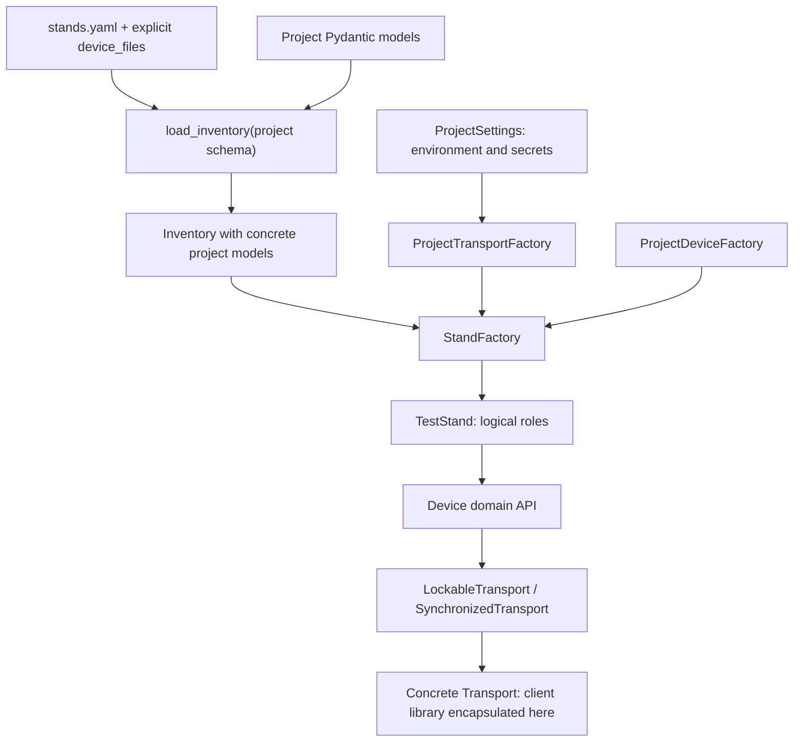
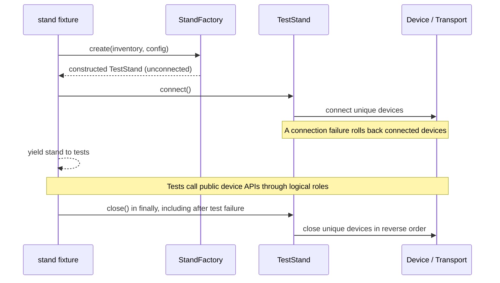

# Custom devices and transports

Projects can add equipment APIs and connection implementations without editing `hardware_test`.
The extension points are typed inventory schemas and constructor-injected factories, as recorded
in [ADR 0003](decisions/0003-explicit-custom-entity-factories.md). These are evolving template APIs;
[ADR 0001](decisions/0001-prepare-for-library-publication.md) does not promise library compatibility.

## Construction flow



The project imports library contracts; the library never imports the project's package. The
loader validates data, factories construct objects, and fixtures coordinate connection lifecycle.

| Responsibility | Location |
| --- | --- |
| Generic models, safe YAML loading, duplicate/reference checks | `hardware_test.inventory` |
| Factory contracts, built-in adapters, physical-ID reuse | `hardware_test.factory` |
| Device API and transport protocols, stand lifecycle | `hardware_test` |
| Custom models, devices, transport implementation, settings and composition | Project package |
| Selection and connection cleanup | Project pytest fixtures |
| Expected measurements and scenario inputs | `configs/` and tests |

## Executable example and project layout

[docs/examples/custom_entities.py](examples/custom_entities.py) contains the complete typed model,
settings, device, transport-adapter, and factory example. It is outside the library package and
is not shipped in its wheel. Its `ConsoleClient` is a project-internal adapter contract; it does
not implement a TCP wire protocol or open sockets by itself.

The [integration tests](../tests/integration/test_custom_entities.py) provide fake clients and run
all four built-in/custom device and transport combinations. Run them without any equipment:

```bash
uv run pytest tests/integration/test_custom_entities.py -vv
```

When adopting the example, place its definitions in a project-owned package, for example:

```text
src/project_hardware/
    inventory.py       # Custom models and explicit supported unions
    settings.py        # Runtime defaults and secret profiles
    devices.py         # CustomMeter domain API
    transport.py       # TcpConsoleTransport and its concrete client adapter
    factory.py         # Project factories and composition
tests/
    conftest.py        # Override settings, inventory and stand_factory
    hardware/
        conftest.py    # Shared stand lifecycle fixture
inventory/
    stands.yaml
    devices.yaml
```

The single example module keeps the demonstration together; splitting it is a project choice.
Ensure the project package is included in that project's build configuration. Runtime client
libraries belong in its runtime dependencies.

## 1. Define strict inventory models

Models contain physical parameters and credential references, never secrets. Use ordinary
Pydantic models. The transport discriminator selects one of the explicitly supported models:

```python
from typing import Annotated, Literal

from pydantic import BaseModel, ConfigDict, Field

from hardware_test.inventory import DeviceConfig, TransportConfig


class TcpConsoleTransportConfig(BaseModel):
    model_config = ConfigDict(extra="forbid")

    type: Literal["tcp_console"]
    host: str = Field(min_length=1)
    port: int = Field(ge=1, le=65535)
    credentials: str = Field(min_length=1)


type ProjectTransportConfig = Annotated[
    TransportConfig | TcpConsoleTransportConfig, Field(discriminator="type")
]


class BuiltinDeviceConfig(DeviceConfig[ProjectTransportConfig]):
    type: Literal["dut", "analyzer", "generator"]


class CustomMeterConfig(DeviceConfig[ProjectTransportConfig]):
    type: Literal["custom_meter"]
    channel: int = Field(ge=1)


type ProjectDeviceConfig = Annotated[
    BuiltinDeviceConfig | CustomMeterConfig, Field(discriminator="type")
]
```

Both device models use the same extended transport union. Consequently a standard `Dut` can
use `tcp_console`, and `CustomMeter` can use SSH. Narrowing the built-in device `type` to literals
also allows a discriminated device union and rejects unregistered types during loading.

`channel` selects a physical meter input. Expected values and tolerances belong in scenario
configs or tests. Models inheriting `DeviceConfig` inherit `extra="forbid"`.

## 2. Describe equipment and logical roles

`inventory/stands.yaml`:

```yaml
version: 1
device_files:
  - devices.yaml
stands:
  measurement-stand:
    description: Stand with an example meter
    devices:
      reference_meter: meter-01
```

`inventory/devices.yaml`:

```yaml
version: 1
devices:
  meter-01:
    type: custom_meter
    model: example-meter
    channel: 2
    transport:
      type: tcp_console
      host: 192.0.2.30
      port: 9000
      credentials: meter_link
```

Every `device_files` path resolves against `stands.yaml`. IDs are unique across all listed files;
duplicates identify both sources. Adding a model or factory never enables glob discovery or
Python class imports from YAML.

## 3. Extend runtime settings for secrets

```python
from pydantic import BaseModel, Field, SecretStr

from hardware_test.settings import CredentialSettings, Settings


class TcpCredentialSettings(BaseModel):
    username: str
    password: SecretStr


class ProjectCredentialSettings(CredentialSettings):
    tcp: dict[str, TcpCredentialSettings] = Field(default_factory=dict)


class ProjectSettings(Settings):
    credentials: ProjectCredentialSettings = Field(default_factory=ProjectCredentialSettings)
```

`ProjectSettings` inherits `.env` loading, the `HARDWARE_TEST_` prefix, and `__` nesting delimiter.
Use these names in the local `.env`; commit only empty placeholders in `.env.example`:

```dotenv
HARDWARE_TEST_CREDENTIALS__TCP__METER_LINK__USERNAME=
HARDWARE_TEST_CREDENTIALS__TCP__METER_LINK__PASSWORD=
HARDWARE_TEST_CONNECT_TIMEOUT=10
HARDWARE_TEST_COMMAND_TIMEOUT=30
```

The inventory reference `meter_link` selects `settings.credentials.tcp["meter_link"]`. Existing
SSH and console profiles continue to work. Credentials remain `SecretStr` until the concrete
client integration needs their value; neither factories nor logs should expose it.

## 4. Implement the device and transport contracts

`CustomMeter` inherits `Device`, receives `LockableTransport`, `model`, and `channel` through its
constructor, and exposes `measure()`. That method submits a typed command and converts the
response to a domain value. It does not read inventory, load settings, or assert test expectations.
The concrete example is in [CustomMeter](examples/custom_entities.py).

`TcpConsoleTransport` implements `Transport`: `connect`, `close`, and `execute`. Its internal
client adapter encapsulates the chosen wire protocol/library. It rejects incompatible command
types, uses explicit command timeouts or the runtime default, and translates client errors to
transport exceptions without exposing credentials. Timeouts become `TransportTimeoutError`.
Connection setup cleans up partial resources on failure; a cleanup error emits a separate safe
warning while the connection error remains primary. `connect` and `close` must support repeated
lifecycle calls; the real client adapter in a downstream project must provide that behavior.

See [transport contracts](transports.md) for synchronization and command semantics. The example
uses an injected fake client in tests; implement and fake the actual client adapter when adding
a real connection method.

## 5. Implement project factory dispatch

The device factory accepts the shared base specialized with the project transport union.
Narrow a custom model before using its extra fields:

```python
def create(
    self,
    config: DeviceConfig[ProjectTransportConfig],
    transport: LockableTransport,
) -> Device:
    if isinstance(config, CustomMeterConfig):
        return CustomMeter(transport, config.model, channel=config.channel)
    return create_device(config, transport)
```

This is the `ProjectDeviceFactory.create` method. Its input deliberately covers the shared
device-config base, rather than only a narrower union. That makes it compatible with the
`DeviceFactory[ProjectTransportConfig]` protocol.

`ProjectTransportFactory` receives `ProjectSettings` and its client constructor through its
constructor. For `TcpConsoleTransportConfig`, it resolves credentials, creates the transport, and
returns `SynchronizedTransport(transport)`. For other supported configurations it delegates to
`create_transport(config, settings)`, whose result is already synchronized. Missing credentials
raise `FactoryError` before client construction. See the complete
[ProjectTransportFactory](examples/custom_entities.py) implementation.

Compose both explicitly:

```python
factory = StandFactory[ProjectTransportConfig](
    device_factory=ProjectDeviceFactory(),
    transport_factory=ProjectTransportFactory(settings, client_factory=create_client),
)
```

Here `create_client` is a project function returning the transport's internal client adapter.
It must construct an unconnected client. No factory opens a connection or mutates a global
constructor table.

## 6. Load the project schema and create a stand

```python
from pydantic import TypeAdapter

from hardware_test.inventory import DeviceInventory, Inventory, get_stand, load_inventory

inventory = load_inventory(
    path,
    device_inventory_adapter=TypeAdapter(DeviceInventory[ProjectDeviceConfig]),
    inventory_adapter=TypeAdapter(Inventory[ProjectDeviceConfig]),
)
stand = factory.create(inventory, get_stand(inventory, "measurement-stand"))
```

Both adapters use the same concrete `ProjectDeviceConfig`. The first validates every device
source; the second validates and constructs the final inventory. The return type and runtime
schema are `Inventory[ProjectDeviceConfig]`. Custom models and fields survive merging and JSON
restoration through `type(inventory).model_validate_json(inventory.model_dump_json())`; invalid
device data remains rejected. A generic function's type parameter alone is not a concrete runtime
schema.

Supply both adapters together for a custom schema. Omitting both selects the original built-in
schema; a factory alone cannot enable a new YAML type. Custom callers that previously supplied
only `device_inventory_adapter` must also provide `inventory_adapter`.

`StandFactory` reads the inventory through `InventoryView[ProjectTransportConfig]`, a read-only
device mapping. It creates one object per physical ID even if several roles reference it.
Existing callers can still use `create_stand(inventory, config, settings)` for standard equipment.

## 7. Override project pytest fixtures

Replace the template definitions of `settings`, `inventory`, and `stand_factory` in
`tests/conftest.py` with project implementations. Keep reporting policy in that file intact.
For example, after moving the example definitions into `project_hardware`:

```python
from pathlib import Path

import pytest

from hardware_test.exceptions import HardwareTestError
from hardware_test.factory import StandFactory
from hardware_test.inventory import Inventory
from project_hardware.factory import build_stand_factory, load_project_inventory
from project_hardware.inventory import ProjectDeviceConfig, ProjectTransportConfig
from project_hardware.settings import ProjectSettings
from project_hardware.transport import create_client


@pytest.fixture(scope="session")
def settings() -> ProjectSettings:
    return ProjectSettings()


@pytest.fixture(scope="session")
def inventory(pytestconfig: pytest.Config) -> Inventory[ProjectDeviceConfig]:
    path: Path = pytestconfig.getoption("inventory")
    try:
        return load_project_inventory(path)
    except HardwareTestError as error:
        raise pytest.UsageError(str(error)) from error


@pytest.fixture(scope="session")
def stand_factory(settings: ProjectSettings) -> StandFactory[ProjectTransportConfig]:
    return build_stand_factory(settings, client_factory=create_client)
```

The shared `stand` fixture in `tests/hardware/conftest.py` continues to select `--stand`, create
the stand, and close it in `finally`. Fixture injection is performed by pytest at runtime; use
the project's specialized annotations on fixture overrides and direct composition code.



Tests obtain the API with `stand.device("reference_meter", CustomMeter)` and validate the returned
measurement. A custom primary DUT may inherit `Dut` to remain compatible with `stand.dut`.
Custom roles do not require adding properties to `TestStand`.

## Verification and common mistakes

Verify models, settings, factory dispatch, and lifecycle with fake clients before equipment use.
Cover both built-in/custom directions, custom field preservation, missing credentials, malformed
inventory, duplicate IDs, shared roles, and cleanup after failures. Include the project package
in static checking. The example here is included in `ty` and exercised by integration tests.

| Symptom | Check |
| --- | --- |
| Custom transport rejected while loading YAML | Pass the project inventory adapter, and extend each device model's transport type |
| Custom device fields unavailable in factory | Narrow the concrete model with `isinstance`; preserve it through the loader |
| Factory rejected by the type checker | Accept `DeviceConfig[ProjectTransportConfig]` and use the same transport union throughout |
| Credentials profile missing | Instantiate `ProjectSettings` and match the inventory reference to the nested environment key |
| Custom factory unused in hardware fixture | Replace the project-level `stand_factory` fixture; check for closer fixture overrides |

Run `./scripts/ci.sh` for the full non-hardware quality gate after relevant checks. Hardware runs
remain explicit and require a prepared stand; adding an extension does not authorize them.

AI agents can use [add-custom-device](../skills/add-custom-device/SKILL.md) or
[add-custom-transport](../skills/add-custom-transport/SKILL.md) for these workflows.
