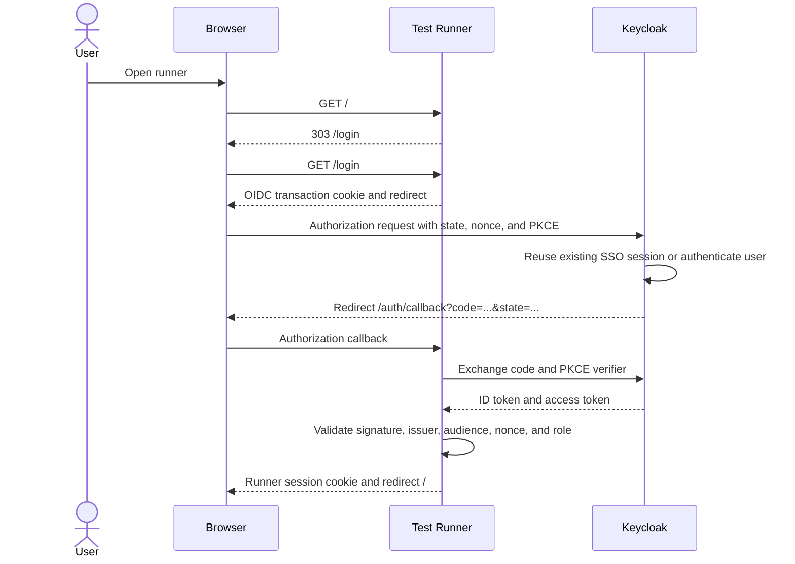
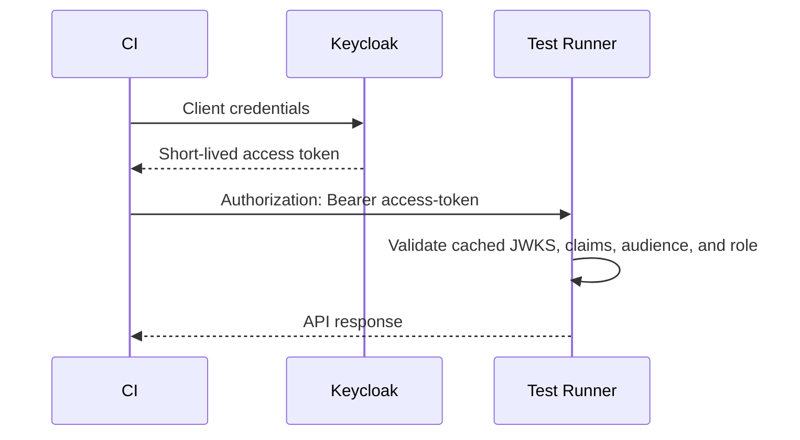

# Authentication

The test runner supports three mutually exclusive modes:

| Mode | Browser UI | API and CI |
| --- | --- | --- |
| `disabled` | No authentication | No authentication |
| `local` | Local username/password and signed cookie | Optional static Bearer token |
| `keycloak` | OpenID Connect SSO and signed runner cookie | Keycloak access token |

`/health` and the endpoints needed to start or finish authentication remain public. All other UI,
API, artifact, event-stream, and OpenAPI routes are protected when authentication is enabled.

## Local mode

Configure the built-in login in the untracked `.env` file:

```dotenv
TEST_RUNNER_AUTH_MODE=local
TEST_RUNNER_AUTH_USERNAME=operator
TEST_RUNNER_AUTH_PASSWORD=replace-with-a-strong-password
TEST_RUNNER_AUTH_SESSION_SECRET=replace-with-a-long-random-value
TEST_RUNNER_AUTH_API_TOKEN=replace-with-an-independent-ci-token
TEST_RUNNER_AUTH_COOKIE_SECURE=true
```

`TEST_RUNNER_AUTH_API_TOKEN` is optional and is accepted only in local mode. Send it as
`Authorization: Bearer <token>`. Generate the password, session secret, and API token independently.

The browser receives a signed `HttpOnly`, `SameSite=Lax` cookie. Its default lifetime is seven days
and can be changed with `TEST_RUNNER_AUTH_SESSION_TTL_SECONDS`. Changing the session secret
invalidates existing sessions.

## Keycloak mode

Keycloak mode uses Authorization Code Flow with PKCE for the browser and locally validated access
tokens for API clients. It does not accept `TEST_RUNNER_AUTH_API_TOKEN`; configuring that variable
in Keycloak mode is a startup error.

### Browser UI and SSO



Users who already have a session in the same Keycloak realm normally return without entering their
credentials again. The runner cookie contains only the authenticated identity and roles; it does
not contain the client secret or refresh token.

The **Sign out** action deletes the runner cookie and redirects to the Keycloak end-session
endpoint. Ending the Keycloak SSO session can also sign the user out of other applications in that
realm.

### API and CI



The runner obtains OIDC discovery metadata and signing keys from Keycloak and caches the JWKS. It
does not call Keycloak for every API request. An unknown signing-key ID triggers one JWKS refresh,
which supports normal signing-key rotation.

### Keycloak clients and roles

Create a confidential OIDC client for the browser application:

- client ID: `hardware-test-runner`;
- standard flow enabled;
- exact valid redirect URI: `https://runner.example.internal/auth/callback`;
- exact valid post-logout redirect URI: `https://runner.example.internal/login`;
- no wildcard redirect URIs;
- client authentication enabled.

Create client roles on `hardware-test-runner`:

- `hardware-test-runner.viewer` can view status, logs, events, and artifacts;
- `hardware-test-runner.operator` also implies viewer access and can build, pull, run, and cancel.

Ensure those roles are included in `resource_access.hardware-test-runner.roles` in both the ID token
and access token. Ensure the access token contains `hardware-test-runner` in its `aud` claim,
normally through a Keycloak audience mapper.

For CI, create a separate confidential client with service accounts enabled. Assign the runner's
`operator` client role to its service account. Do not reuse the browser client's secret in CI.

### Runner environment

```dotenv
TEST_RUNNER_AUTH_MODE=keycloak
TEST_RUNNER_PUBLIC_URL=https://runner.example.internal
TEST_RUNNER_OIDC_ISSUER=https://sso.example.internal/realms/engineering
TEST_RUNNER_OIDC_CLIENT_ID=hardware-test-runner
TEST_RUNNER_OIDC_CLIENT_SECRET=replace-with-browser-client-secret
TEST_RUNNER_OIDC_AUDIENCE=hardware-test-runner
TEST_RUNNER_OIDC_VIEWER_ROLE=hardware-test-runner.viewer
TEST_RUNNER_OIDC_OPERATOR_ROLE=hardware-test-runner.operator
TEST_RUNNER_AUTH_SESSION_SECRET=replace-with-a-long-random-value
TEST_RUNNER_AUTH_SESSION_TTL_SECONDS=3600
TEST_RUNNER_AUTH_COOKIE_SECURE=true
```

`TEST_RUNNER_PUBLIC_URL` is authoritative for callback and logout URLs. It must be the externally
reachable HTTPS origin and must match the Keycloak client configuration.

### CI example

Store the CI client ID and secret as masked, protected variables. Obtain a short-lived token:

```bash
ACCESS_TOKEN="$(${CURL:-curl} --fail --silent --show-error \
  --request POST \
  --data-urlencode 'grant_type=client_credentials' \
  --data-urlencode "client_id=${KEYCLOAK_CLIENT_ID}" \
  --data-urlencode "client_secret=${KEYCLOAK_CLIENT_SECRET}" \
  "${KEYCLOAK_ISSUER}/protocol/openid-connect/token" \
  | jq --raw-output '.access_token')"
```

Use it without placing it in a URL or log:

```bash
curl --fail --request POST "${TEST_RUNNER_URL}/v1/runs" \
  --header "Authorization: Bearer ${ACCESS_TOKEN}" \
  --header 'Content-Type: application/json' \
  --data '{
    "image": "sha256:0123456789abcdef",
    "stand": "stand-01",
    "scenario": "hardware-smoke"
  }'
```

## Authorization results

- `401 Unauthorized`: no valid session or token was supplied;
- `403 Forbidden`: the identity is valid but lacks the required viewer or operator role.

## Deployment requirements

- Use HTTPS and set `TEST_RUNNER_AUTH_COOKIE_SECURE=true` outside loopback development.
- Keep client secrets and session secrets out of Git and container images.
- Do not expose the runner through an untrusted proxy path; it controls Docker and physical test
  stands.
- Keep the issuer, public URL, redirect URLs, audience, and role mappings exact.
- Discovery and token endpoints must use HTTPS and be reachable from the runner container.
